# Folio

[](https://github.com/MAX959954/hotel-reservation-system/actions/workflows/ci.yml)
[](LICENSE)

**Folio is a hotel and apartment booking platform, built as the practical part of a
bachelor's thesis.**

| | |
|---|---|
| **Thesis** | *Development of a Web Application for Hotel Reservation Management* |
| **Author** | Maksym Veselov |
| **Supervisor** | Mgr. Dominik Halvoník |
| **Faculty** | Fakulta prírodných vied a informatiky |
| **Year** | 2026 |

Folio works like a small Booking.com: many independent hotel companies list their
properties in one shared catalogue, guests search and book across all of them, and each
company runs its own hotels, bookings and staff through a separate extranet.

**Goal of the work:** a complete, realistic system rather than a prototype. That means
real sign-in with e-mail verification, a booking lifecycle with rules and automatic
clean-up, card payments through Stripe with refunds, permissions per company, about 425
automated tests, and a production deployment.

**Stack:** Spring Boot 3 (Java 17) · PostgreSQL 16 · Redis 7 · Vue 3 + TypeScript + Vite ·
Docker Compose · Stripe

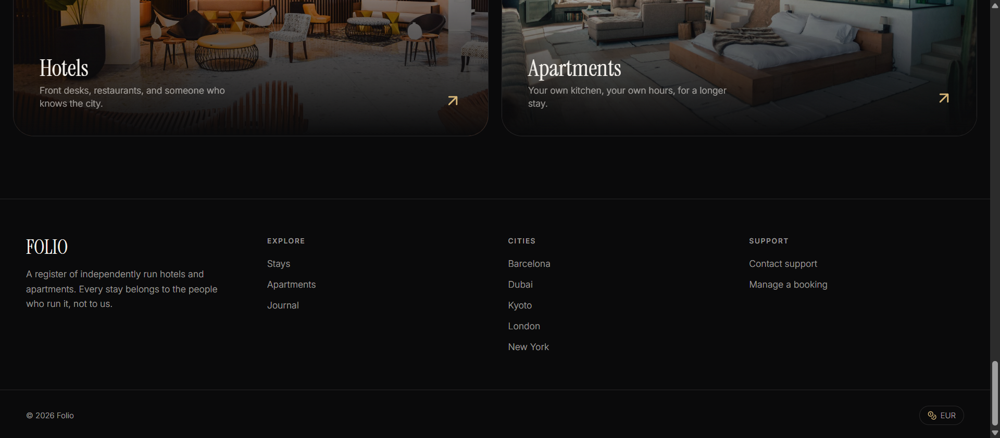

**Names in this repository.** *Folio* is the product name (what users see in the UI, in
e-mails and in the API docs). `hotel-reservation-system` is the name of the Git
repository. `Hotel-system/` is the backend (a Gradle project, Java base package
`com.folio`) and `frontend/` is the Vue app. To run the project, use the
`docker-compose.yml` in the repository root: it includes `Hotel-system/docker-compose.yml`
(database, Redis, mail catcher, API) and adds the frontend. `deploy/` holds the separate
production compose files.

## Contents

1. [Features](#1-features)
2. [Quick start](#2-quick-start)
3. [Architecture](#3-architecture) (full version: [docs/ARCHITECTURE.md](docs/ARCHITECTURE.md))
4. [How it works](#4-how-it-works): reservations, payments, refunds, sign-in and security
5. [Screenshots](#5-screenshots)
6. [API documentation](#6-api-documentation)
7. [Development and tests](#7-development-and-tests)
8. [Deployment](#8-deployment)
9. [Troubleshooting and known limitations](#9-troubleshooting-and-known-limitations)
10. [License](#10-license)

---

## 1. Features

**Guest**
- search stays by city, dates and number of guests: 44 hotels and apartments in 10 cities
- use the site in 7 languages (EN, SK, RU, ES, FR, IT, JA), with prices in EUR plus estimates in other currencies
- book a room; availability and price are checked on the server
- pay by card or Google Pay (Stripe), or choose bank transfer, cash on arrival or crypto
- cancel: free until 48 h before check-in, then a one-night fee; refunds are automatic
- get e-mails at every step; manage the profile and avatar; apply to become a host

**Hotel company (extranet)**, with the company roles owner, manager, receptionist, accountant and staff
- confirm, check in, complete or cancel bookings; mark offline payments as paid
- manage hotels and rooms (prices, capacity, room status such as maintenance)
- invite staff by e-mail with a company role; every role only sees its own company
- reviews: guests can review a completed stay and staff approve them (API only, no screen yet)

**Administrator**
- approve or reject host applications and view the uploaded documents
- manage users: search, change account status, grant or revoke roles

**Under the hood**
- sign-in with password plus an e-mail code, or Google; JWT with rotating refresh tokens
- scheduled jobs cancel unconfirmed or unpaid bookings and expire abandoned payments
- 425 automated backend tests (296 unit, 85 web-layer component and 44 integration tests against a real PostgreSQL and Redis), run by CI on every push
- interactive API documentation (Swagger UI)

**A quick look** (more in [Screenshots](#5-screenshots)):

| Search | Booking and payment | Hotel extranet |
|---|---|---|
| 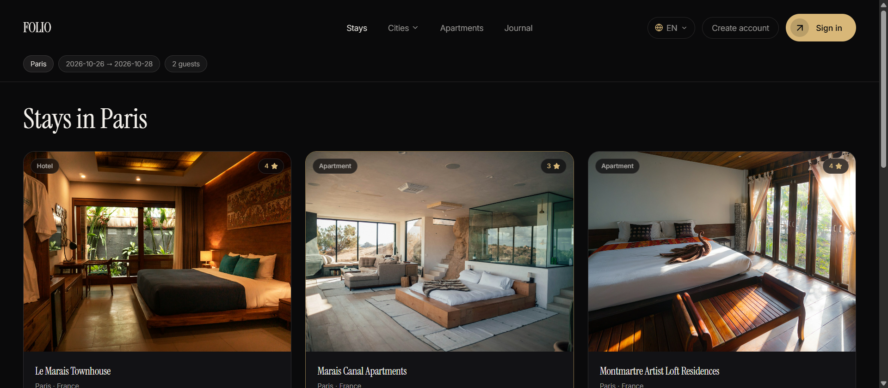 | 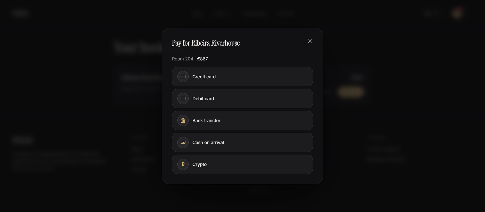 | 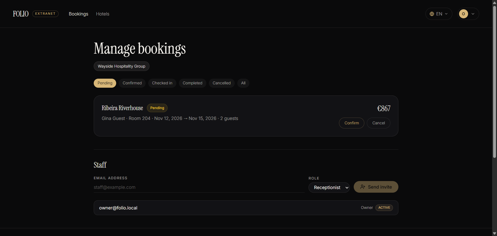 |

---

## 2. Quick start

**Needs:** [Git](https://git-scm.com/downloads) and
[Docker Desktop](https://www.docker.com/products/docker-desktop/), running. No Java,
Node.js, PostgreSQL or Redis on the machine, and no `.env` file: every setting has a
working local default.

```bash
git clone https://github.com/MAX959954/hotel-reservation-system.git
cd hotel-reservation-system
docker compose up --build
```

The first start takes 5–10 minutes (Docker downloads images and builds the backend and
frontend); later starts take seconds. When the log shows
`Started HotelSystemApplication`, open:

| What | URL |
|---|---|
| **Website** | **http://localhost:5173** |
| **Mail inbox** (sign-in codes and all other e-mails arrive here) | **http://localhost:8025** |
| API documentation (Swagger UI) | http://localhost:8081/swagger-ui.html |
| API health check | http://localhost:8081/actuator/health (shows `{"status":"UP"}`) |

### Test accounts

The password is `Folio2026!` for all three.

| E-mail | Role |
|---|---|
| `guest@folio.local` | guest: book and pay |
| `owner@folio.local` | owner of *Wayside Hospitality Group*: its hotels, rooms, bookings and staff (extranet) |
| `admin@folio.local` | administrator: host applications, users |

After the password the site asks for a **6-digit code**. Open http://localhost:8025: the
newest e-mail, "Your Folio verification code", contains it (valid for 10 minutes). You can
also register your own account with any e-mail address, even a made-up one, because
nothing is actually sent.

### A five-minute tour

Use two browsers (or a private window) to be signed in as guest and owner at the same time.

| Step | As | What to do | Expected result |
|---|---|---|---|
| 1 | visitor | on the home page pick **Paris**, switch the language (top right) | a list of Paris stays, translated |
| 2 | guest | open *Ribeira Riverhouse*, choose dates, **Reserve** | the booking is in **My bookings** as *Pending* |
| 3 | owner | account menu → **Manage bookings** → **Confirm** | *Confirmed*; the guest gets an e-mail in Mailpit |
| 4 | guest | **My bookings** → **Pay now** → **Bank transfer** | *Payment method saved*, nothing charged |
| 5 | owner | **Mark as paid**, then **Check in** | *Paid · Bank transfer*, then *Checked in* |
| 6 | guest | **Become a host**, submit the form with any document | application sent |
| 7 | admin | account menu → **Admin** → approve the application | the applicant now owns a new company and can add hotels |

Card payments need Stripe test keys, see [Optional integrations](#optional-integrations).

**Stop** with `Ctrl+C` or `docker compose down`. The data is kept in a Docker volume;
`docker compose down -v` resets it to the demo data.

---

## 3. Architecture

### Components

The production deployment (the same diagram as Figure 2 of the thesis):

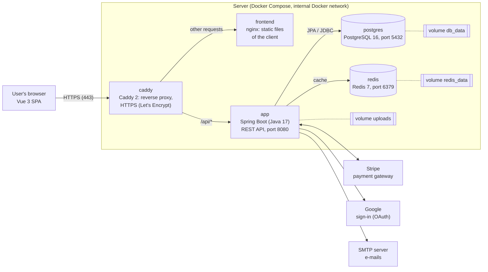

Locally, `docker compose up` starts five containers without Caddy: `hotel_frontend`
(nginx with the Vue app, port 5173), `hotel_app` (the API, 8081), `hotel_db` (PostgreSQL,
5432), `hotel_redis` (6379) and `hotel_mailpit` (a fake SMTP server with a web inbox,
8025). The browser calls the frontend and the API directly.

### Technology choices

| Choice | Why |
|---|---|
| **Spring Boot 3** | Spring Security, Spring Data JPA, declarative transactions, scheduling, caching and test support in one mature framework |
| **PostgreSQL** | bookings and payments need real transactions and constraints; money is stored as exact `numeric(12,2)` |
| **Redis** | data that must expire on its own (refresh tokens, revoked tokens) and shared caches; its TTLs replace clean-up jobs |
| **JWT + refresh tokens** | a stateless API: a restart or redeploy logs nobody out, and tokens can still be revoked |
| **E-mail code at sign-in** | a leaked password alone is not enough to get in; every sign-in proves the user still owns the address |
| **Stripe** | card data never touches this server, 3-D Secure works out of the box, and test mode allows a full demo with no real money |
| **Flyway** | the schema is versioned SQL, applied identically to local, test and production databases |
| **Vue 3 + TypeScript** | a typed single-page app; Pinia for state, vue-i18n for the 7 languages, Tailwind for styling |
| **Docker Compose** | one command starts the whole stack, with the same images in development and production |

### Considered alternatives

| Instead of | Why not |
|---|---|
| **Microservices** | one team and one database; a modular monolith (packages by feature) keeps transactions simple, for example cancelling a booking and refunding it in one transaction, and could still be split along the package boundaries later |
| **Server-side sessions** | they would need sticky sessions or a shared session store, and every restart would log users out; JWT keeps the API stateless, and Redis covers the one thing JWT can't do alone (revocation) |
| **Keycloak or Auth0** | an extra service to run, or an external dependency, for one application; Spring Security covers password, e-mail code and Google sign-in, and keeps the sign-in flow part of the thesis code |
| **Password only** | the e-mail code adds one step on every sign-in, a deliberate trade of convenience for security: a leaked password alone is not enough. The code is valid for 10 minutes, and the refresh token keeps users signed in for 30 days, so it is needed only on a new sign-in |
| **Own card handling** | storing or even receiving card numbers would bring the server into PCI DSS scope; with Stripe Elements the card data goes from the browser straight to Stripe |

### Backend structure

Packages are organised **by feature** under `com.folio`: `booking`, `payment`, `hotels`,
`room`, `reviews`, `companies`, `companyuser` (staff and per-company permissions),
`user` (accounts, sign-in, JWT, e-mail), `admin`, plus `config` and `exception`. Every
feature repeats the same layers:

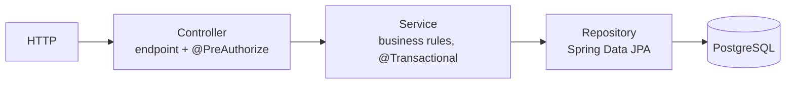

Controllers accept validated `*Request` DTOs and return `*Response` DTOs, so entities
never leave the service layer. Errors are exceptions that `GlobalExceptionHandler` turns
into one JSON error format with the right HTTP status.

### Data model

All 13 tables of the PostgreSQL schema (the same diagram as Figure 3 of the thesis):

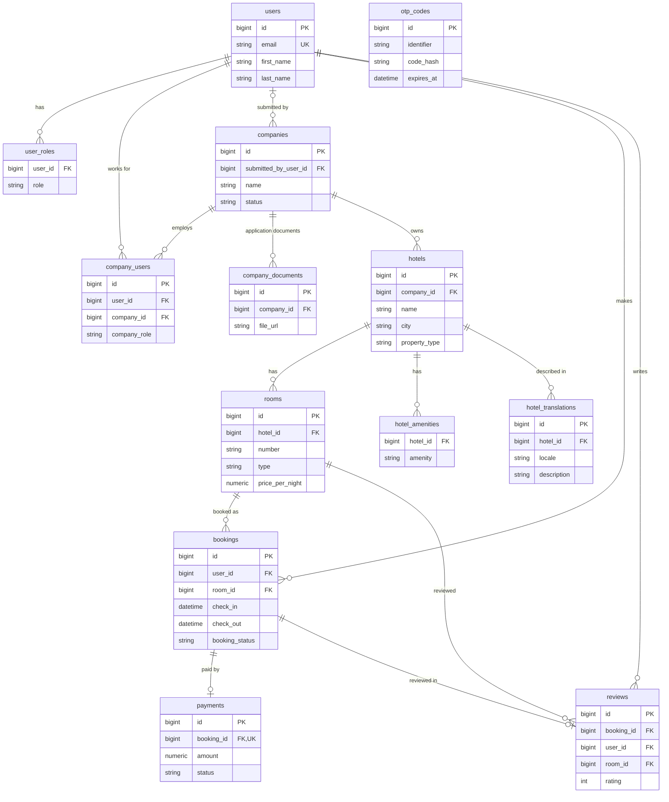

A company owns hotels; people work for a company through `company_users`, each with a
company role, and one person can belong to several companies. A booking is for one room
and has at most one payment and one review. `otp_codes` (sign-in codes) is keyed by the
e-mail address, not by a foreign key. The schema is created by the Flyway migrations
`V1`–`V4` in `Hotel-system/src/main/resources/db/migration/`. The sign-in sequence and the
role model are in **[docs/ARCHITECTURE.md](docs/ARCHITECTURE.md)**.

---

## 4. How it works

### Booking lifecycle

The same states and transitions as Figure 4 of the thesis:

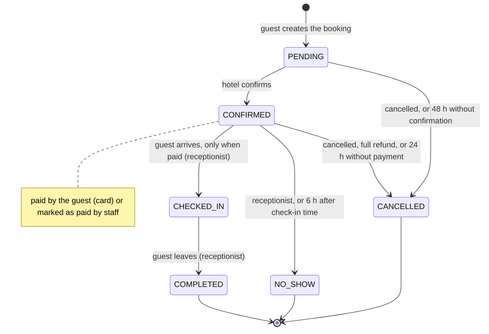

**Creating a booking** (`POST /api/bookings`). The backend checks that:
- check-out is after check-in and the stay is at least one night;
- the hotel and its company are active and the room isn't in maintenance or out of order;
- the room isn't already booked for any overlapping date;
- the number of guests fits the room's capacity.

The price is `nightly price × nights`, calculated with `BigDecimal` (exact cents) and
stored on the booking. Later price changes don't affect existing bookings.

**Who does what:**

| Action | Who | Allowed when |
|---|---|---|
| Reserve | guest | room free for the dates |
| Confirm | hotel staff | booking is `PENDING` |
| Pay | guest | booking is `CONFIRMED` |
| Check in | hotel staff | booking is `CONFIRMED` **and paid** |
| Complete | hotel staff | booking is `CHECKED_IN` |
| Cancel | guest or hotel staff | booking is `PENDING` or `CONFIRMED` (not after check-in) |

**Automatic jobs** (`BookingLifecycleScheduler`, `PaymentLifecycleScheduler`, every 15
minutes) keep stale bookings from blocking rooms:

| Job | Default | Setting |
|---|---|---|
| Cancel a `PENDING` booking the hotel never answered | after 48 h | `BOOKING_PENDING_HOLD_HOURS` |
| Cancel a `CONFIRMED` booking that was never paid | after 24 h | `BOOKING_PAYMENT_DEADLINE_HOURS` |
| Mark a confirmed booking as `NO_SHOW` when the guest didn't check in | 6 h after check-in time | `BOOKING_NO_SHOW_GRACE_HOURS` |
| Expire a card payment that was started but never finished | after 24 h | `PAYMENT_PENDING_EXPIRY_HOURS` |

### Payments

Payment opens only after the hotel has **confirmed** the booking, so a guest never
pays for a stay the hotel hasn't accepted.

| Method | How it is processed | Who marks it as paid |
|---|---|---|
| Credit / debit card, Google Pay | Stripe PaymentIntent. The browser confirms the card with Stripe.js (including 3-D Secure), then the backend asks Stripe whether the payment really succeeded and that it matches this booking | Stripe (confirm call or webhook), never a person |
| Bank transfer, cash on arrival, crypto | Recorded as *Awaiting payment*. Nothing is charged online | Hotel staff with **Mark as paid** once the money has arrived |

- **One payment per booking.** A failed or abandoned card attempt can be retried.
  Before a retry, the backend checks with Stripe that the earlier attempt wasn't actually
  charged, so a guest can't be charged twice.
- **Stripe webhooks** (`/api/payments/webhook`, signature verified) reconcile
  everything that happens outside the app: a payment that succeeded after the browser
  was closed, a failed payment, or a refund issued from the Stripe Dashboard.
- **Amounts** are `numeric(12,2)` in the database and converted to cents for Stripe.

### Cancellation and refunds

| Who cancels | When | Refund |
|---|---|---|
| Guest | more than **48 h** before check-in (`BOOKING_FREE_CANCELLATION_HOURS`) | full refund |
| Guest | later than that | refund minus a late-cancellation fee of **1 night** (`BOOKING_LATE_CANCELLATION_FEE_NIGHTS`) |
| Hotel, admin, or an automatic job | any time before check-in | full refund |
| Guest doesn't show up (`NO_SHOW`) | — | nothing is refunded |

The cancellation and the refund happen in one database transaction: if Stripe refuses
the refund, the booking stays as it was, so the guest never ends up with a cancelled
stay and no money back. Card refunds are sent to Stripe with an idempotency key, so a
retry can't refund twice. Hotel owners and managers can also issue a full or partial
refund through the API (`PATCH /api/payments/{id}/refund`). A **full** refund of a
confirmed booking cancels it and frees the room.

### Sign-in and security

**Two-step sign-in.** The user enters the password (checked against a BCrypt hash), then a
6-digit code that the API e-mails to them. The code is stored only as a BCrypt hash and
expires after 10 minutes. Registration uses the same code to prove the address. Google
sign-in verifies Google's ID token on the server instead.

**Tokens:**

| Token | Lifetime | Where it lives | How it is revoked |
|---|---|---|---|
| Access token (signed JWT) | 15 min | nowhere, the API is stateless | logout puts its ID on a **blacklist in Redis** until it would have expired; a password change invalidates all older tokens |
| Refresh token | 30 days | Redis | single use: replaced on every refresh, deleted on logout |

**Permissions** have two levels. *Global* roles (`GUEST`, `COMPANY_CLIENT`, `RECEPTIONIST`,
`HOTEL_MANAGER`, `ADMIN`, `SUPPORT`) apply to the whole platform. *Company* roles (`OWNER`, `MANAGER`,
`RECEPTIONIST`, `ACCOUNTANT`, `STAFF`) apply only inside one company. Every endpoint
declares its rule with `@PreAuthorize`, and `CompanyAuthorization` answers questions like
"does this user have one of these roles in the company that owns this booking?". A
receptionist of company A can confirm A's bookings but cannot see company B's at all.

**Brute-force protection:** 5 wrong passwords lock the account for 15 minutes; 5 wrong
codes invalidate the code; at most 5 codes per hour with 30 s between them. In production
the app refuses to start with development settings (`ProductionSafetyCheck`, see
[Deployment](#8-deployment)).

Diagrams and details: [docs/ARCHITECTURE.md → Security](docs/ARCHITECTURE.md#5-security).

---

## 5. Screenshots

All screenshots come from the local Docker build with the demo data.

### Guest side

| | |
|---|---|
| **Search by city and dates**<br>Pick a city, dates and number of guests. Only stays in that city are listed. |  |
| **Hotel page**<br>Description, amenities and the rooms with their nightly price. | 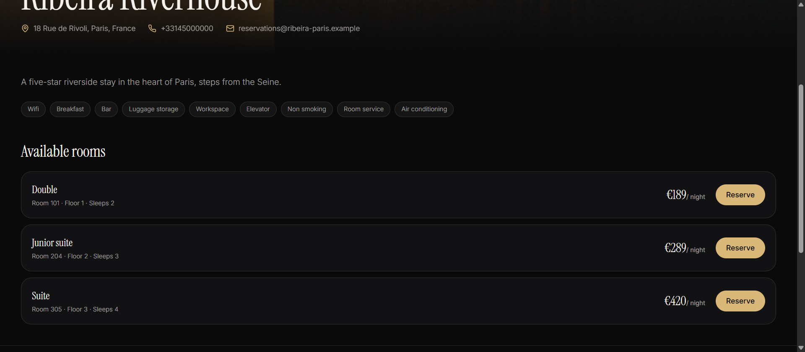 |
| **Reserve a room**<br>The total is calculated live: nights × nightly price. | 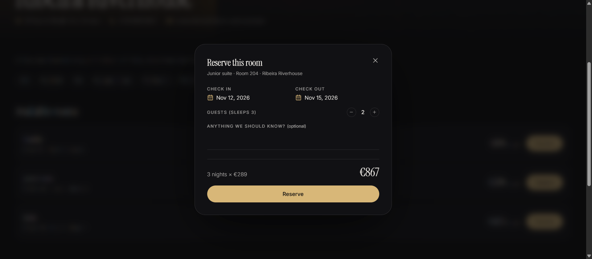 |
| **Sign in with a one-time code**<br>Password first, then a 6-digit code sent by e-mail. | 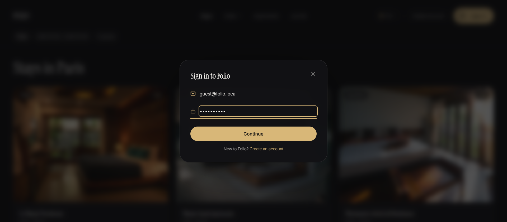 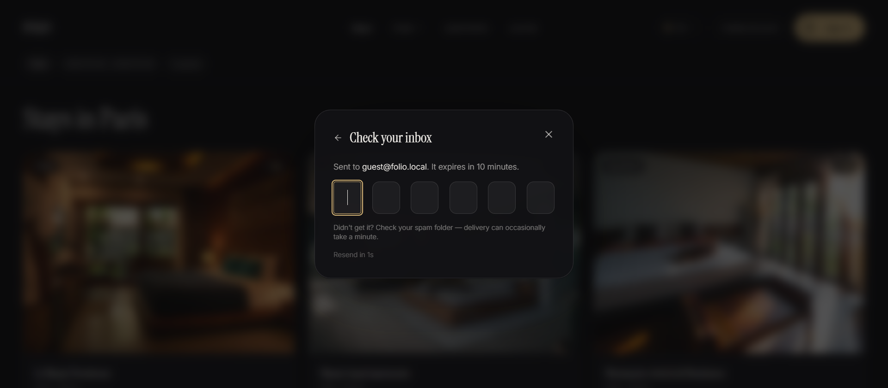 |

### Booking and payment, step by step

| Step | Screen |
|---|---|
| **1. Booking created: Pending**<br>The guest has reserved. The room is held, but the hotel still has to accept it. | 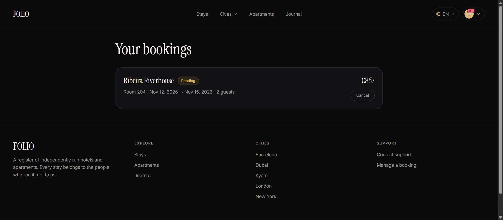 |
| **2. Hotel confirms** (extranet, owner/staff)<br>Staff see new requests under **Pending** and click **Confirm**. |  |
| **3. Guest can pay**<br>A confirmed booking shows **Pay now**. | 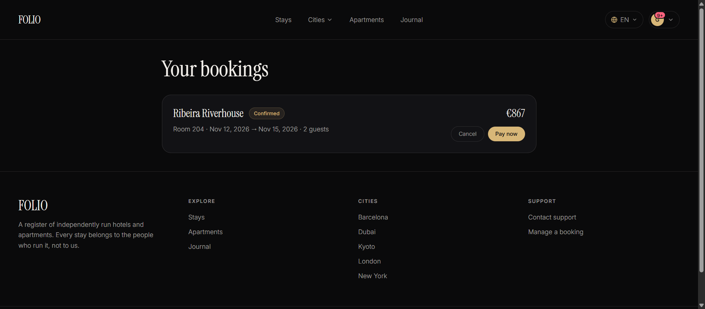 |
| **4. Choose a payment method**<br>Card / Google Pay go through Stripe. Bank transfer, cash and crypto are settled offline. |  |
| **5. Offline method saved**<br>Nothing is charged yet. The booking waits for the hotel to confirm the money arrived. | 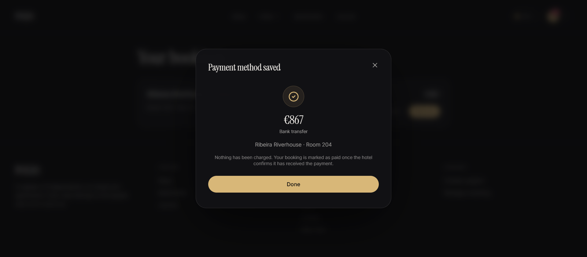 |
| **6. Hotel marks it as paid**<br>The extranet shows *Awaiting payment · Bank transfer* and a **Mark as paid** button. | 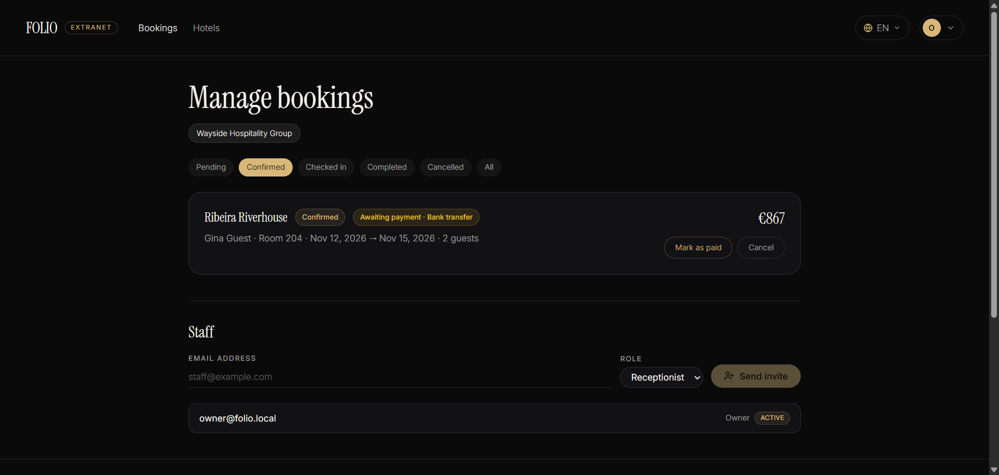 |
| **7. Paid, ready for check-in**<br>Only a paid booking can be checked in. | 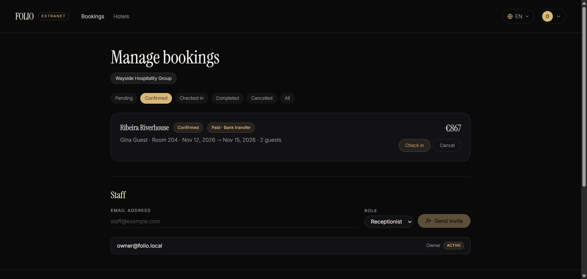 |
| **E-mail notifications**<br>Every step sends an e-mail. Locally they all land in Mailpit (http://localhost:8025). | 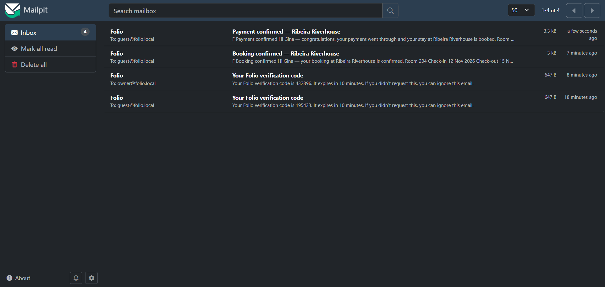 |

---

## 6. API documentation

The backend documents its REST API with OpenAPI (springdoc). With the local stack
running, open:

| What | URL |
|---|---|
| **Swagger UI**: every endpoint, try it from the browser | **http://localhost:8081/swagger-ui.html** |
| OpenAPI spec (JSON) | http://localhost:8081/v3/api-docs |

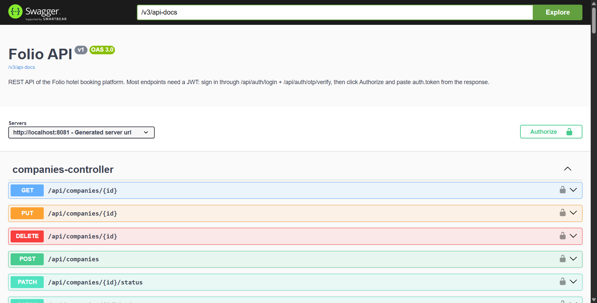

Most endpoints need a signed-in user. Call `POST /api/auth/login` with a test account,
then `POST /api/auth/otp/verify` with the code from Mailpit (http://localhost:8025),
copy `auth.token` from the response, click **Authorize** and paste it.

Swagger is switched off in the `prod` profile, so a public deployment doesn't publish a
map of every endpoint.

---

## 7. Development and tests

### Repository layout

```
.
├── docker-compose.yml      Run this one: the whole local stack (includes Hotel-system/docker-compose.yml + frontend)
├── Hotel-system/           Backend: Spring Boot API (Gradle)
│   ├── src/main/java/com/folio/   Packages by feature: booking, payment, hotels, room, reviews, user, companies, ...
│   ├── src/main/resources/        application*.yml, db/migration (schema), db/seed (demo data), db/seed-accounts
│   ├── src/test/                  Unit, controller and integration tests
│   └── docker-compose.yml         Postgres + Redis + Mailpit + API, with local defaults for every setting
├── frontend/               Frontend: Vue 3 SPA (Vite, Pinia, vue-i18n, Tailwind), served by nginx in Docker
├── docs/                   ARCHITECTURE.md and the README screenshots
├── deploy/                 Production: VPS or own PC via Tailscale, see deploy/README.md
├── scripts/                PowerShell helpers: Cloudflare Tunnel, Tailscale Funnel
└── .github/workflows/      CI (tests on every push) and automatic deploy
```

### Configuration profiles and data

The same code and Docker image run everywhere; only the Spring profile and environment
variables differ.

| Profile | Used by | What it sets |
|---|---|---|
| `local` | `docker compose`, IDE runs | e-mail to Mailpit, a public dev JWT key, sign-in codes also printed to the log |
| `prod` | production (`deploy/`) | real secrets from environment variables, real SMTP; refuses to start with any dev setting |
| `test` | `./gradlew test` | a throwaway PostgreSQL container (Testcontainers) |

On start the backend runs Flyway migrations from `Hotel-system/src/main/resources/db/`:
`db/migration` holds the schema (everywhere), `db/seed` the demo catalogue (4 companies,
44 hotels and apartments in Paris, Rome, Kyoto, Barcelona, Dubai, London, New York, Tokyo,
Santorini and the Maldives, with rooms, translations and reviews), and `db/seed-accounts`
the three test accounts (`local` profile only). The seeds only fill an empty database,
so they never overwrite your own data.

### Everyday commands

Run these from the repository root.

| Task | Command |
|---|---|
| Start in the background | `docker compose up --build -d` |
| Stop (keeps the database) | `docker compose down` |
| Reset the database to the demo data | `docker compose down -v` then `docker compose up --build` |
| Follow backend logs | `docker logs -f hotel_app` |
| Open a SQL shell | `docker exec -it hotel_db psql -U hotel_user -d hotel_db` |

### Hot reload

For frontend work, run the backend in Docker and the Vite dev server directly (needs
**Node.js 20+**):

```bash
docker compose up --build -d postgres redis mailpit app
cd frontend
cp .env.example .env                  # VITE_API_BASE_URL=http://localhost:8081
npm install
npm run dev                           # http://localhost:5173, reloads on save
```

For backend work, run `com.folio.HotelSystemApplication` from IntelliJ IDEA (JDK 17) with
`SPRING_PROFILES_ACTIVE=local` and `PORT=8081`, after `docker compose stop app` and
`docker compose up -d postgres redis mailpit`. Or rebuild the container:
`docker compose up --build -d app`.

### Optional integrations

Everything above works without keys. To enable the external services, copy
`Hotel-system/.env.example` to `Hotel-system/.env` and fill in what you need:

| Feature | Variables | Where to get them |
|---|---|---|
| Card / Google Pay payments | `STRIPE_SECRET_KEY` (`sk_test_...`), optionally `STRIPE_WEBHOOK_SECRET` | Stripe Dashboard → Test mode → Developers → API keys; `stripe listen --forward-to localhost:8081/api/payments/webhook` |
| Real e-mails instead of Mailpit | `MAIL_PROVIDER=sendgrid`, `SENDGRID_API_KEY`, `MAIL_FROM` | https://app.sendgrid.com/settings/api_keys |
| Google sign-in | `GOOGLE_CLIENT_ID` | Google Cloud Console → Credentials → OAuth client ID |

The frontend needs the **public** keys at build time, in a `.env` file in the repository
root: `VITE_STRIPE_PUBLISHABLE_KEY=pk_test_...` and `VITE_GOOGLE_CLIENT_ID=...`. Apply with
`docker compose up --build`. In Stripe test mode, pay with card **4242 4242 4242 4242**,
any future expiry date and any CVC. `.env` files are git-ignored.

### Tests

The backend has **425 automated tests** in 30 test classes (JUnit 5, Mockito, Spring Boot
Test, Testcontainers), split by test level as in Table 5 of the thesis:

| Level | Classes | Tests | What they check |
|---|---|---|---|
| Unit tests (Mockito, no Spring context) | 15 | 296 | one class with mocked dependencies: services, scheduled jobs, JWT service and filter, per-company permissions (`CompanyAuthorization`), error handler; e.g. prices, state transitions, refunds, sign-in limits |
| Component tests of the web layer (`@WebMvcTest`) | 8 | 85 | one controller with mocked services: status codes, request validation, JSON responses and error format |
| Integration tests, real **PostgreSQL 16** | 5 | 31 | the full application against a throwaway database started by **Testcontainers** with the real Flyway migrations: overlap checks, reviews, company memberships, endpoint security for every role |
| Integration tests, real **Redis** | 2 | 13 | refresh-token rotation and the token blacklist |

There are no automated acceptance or end-to-end tests; the main booking flow was tested
by hand in the browser.

Run them (needs JDK 17 and Docker running; Redis must be on `localhost:6379`):

```bash
docker compose up -d redis
cd Hotel-system
./gradlew test          # Windows: .\gradlew test
```

**Coverage** (JaCoCo): **73 % of lines** and **60 % of branches** of the backend. The
test report is in `Hotel-system/build/reports/tests/test/index.html`, the coverage report
in `Hotel-system/build/reports/jacoco/test/html/index.html`.

The frontend has **no automated tests** yet (see [Known limitations](#known-limitations));
CI only type-checks and builds it (`cd frontend && npm ci && npm run build`).

**CI** (`.github/workflows/ci.yml`) runs the backend tests and the frontend build on every
push and pull request to `main`; the badge at the top shows the latest result.

### Sharing a local build

`scripts\start-tunnels.ps1` (Windows) exposes the locally running app through a free
[Cloudflare quick tunnel](https://developers.cloudflare.com/cloudflare-one/connections/connect-networks/)
and prints two public links, handy for testing from a phone. `scripts\stop-tunnels.ps1`
stops it and restores the local settings. Needs `cloudflared`
(`winget install Cloudflare.cloudflared`).

---

## 8. Deployment

Production runs the same Docker images with the `prod` profile behind **Caddy**
(automatic HTTPS) on one domain, either on a **Linux server (VPS)**, with automatic deploys
from GitHub Actions, or on **your own PC** published through **Tailscale Funnel**
(`scripts\public-start.ps1`). Step-by-step guide for both:
**[deploy/README.md](deploy/README.md)**.

In production there are no test accounts, e-mail goes through real SMTP (e.g. Gmail), and
`ProductionSafetyCheck` stops the app at startup if it finds a development setting (dev
JWT key, codes in the log, test accounts).

---

## 9. Troubleshooting and known limitations

### Troubleshooting

**"Cannot reach the server" on the website.** Open http://localhost:8081/actuator/health.
If it doesn't load, the backend is still starting or crashed: `docker logs hotel_app --tail 80`.
If it shows `UP`, `Hotel-system/.env` probably has a stale `CORS_ALLOWED_ORIGINS` (e.g. an
old tunnel URL): empty it, run `docker compose up -d app` and hard-refresh (`Ctrl+F5`).

**`Migrations have failed validation` / `checksum mismatch`, or `password authentication
failed for user "hotel_user"`.** The database volume was created by an older version.
Reset it: `docker compose down -v`, then `docker compose up --build`.

**`port is already allocated`** (5432, 5173, 8081 or 6379). A local PostgreSQL, Redis or
`npm run dev` uses that port. Stop it, or change the left-hand side of the port mapping
in `docker-compose.yml` / `Hotel-system/docker-compose.yml` (e.g. `"5433:5432"`).

**`docker daemon is not running`** or tests fail with `Could not find a valid Docker
environment`. Start Docker Desktop and wait until it's fully up. On Windows it needs WSL 2
(`wsl --update`) and at least 4 GB of RAM.

**No verification code.** Look in Mailpit (http://localhost:8025) or in the log:
`docker logs hotel_app 2>&1 | grep "Verification code"`. Codes are rate-limited (30 s
apart, 5 per hour). 5 wrong passwords lock the account for 15 minutes.

**Code changes don't show up.** Start with `--build`, otherwise Docker reuses the old image.

### Known limitations

- **No frontend tests.** The Vue app is type-checked (`vue-tsc`) and built in CI, but has
  no unit or end-to-end tests. The next step would be Vitest for the Pinia stores and a few
  Playwright tests for the booking flow.
- **Built for a single API instance.** The scheduled jobs (booking clean-up, payment
  expiry) have no distributed lock, so with two or more API instances each job would run
  on every instance. A later run skips bookings that are already cancelled, and Stripe
  refunds carry an idempotency key, but two runs at the same moment are not guarded
  (bookings have no optimistic locking). Scaling out would call for a lock such as
  ShedLock and a `@Version` column on bookings.
- **Reviews have no screen yet.** Submitting and moderating reviews works through the API
  (Swagger) only.
- **No general-purpose rate limiting.** Login and sign-in codes are throttled, but the
  rest of the API has no per-IP or per-user limit. A system with real traffic would add
  this at the reverse proxy or in the app (e.g. Bucket4j).
- **Payments run in Stripe test mode.** Offline methods (bank transfer, cash, crypto) are
  only recorded; the hotel confirms the money by hand.

---

## 10. License

[MIT](LICENSE)
