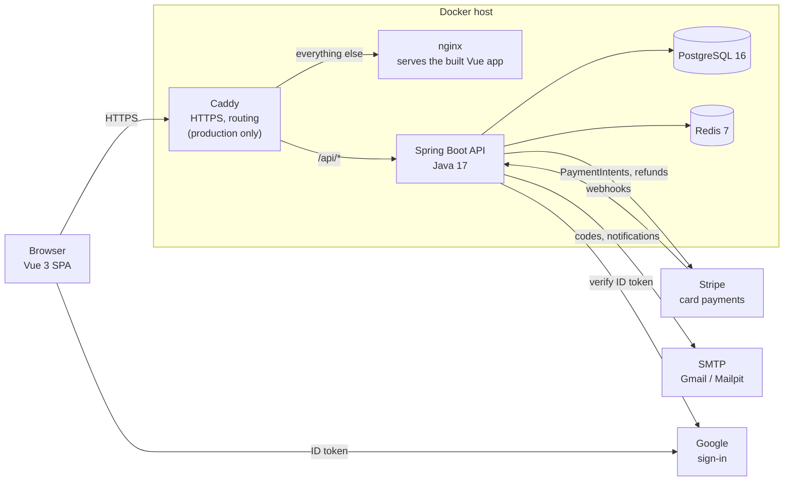
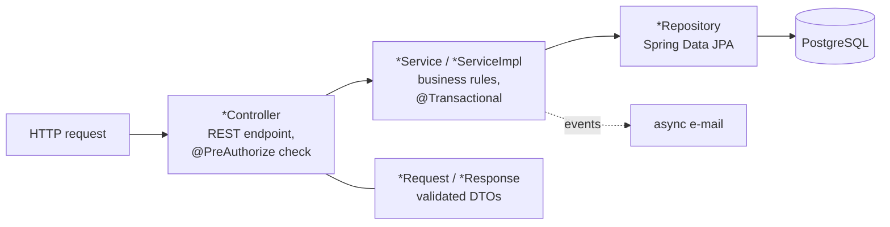
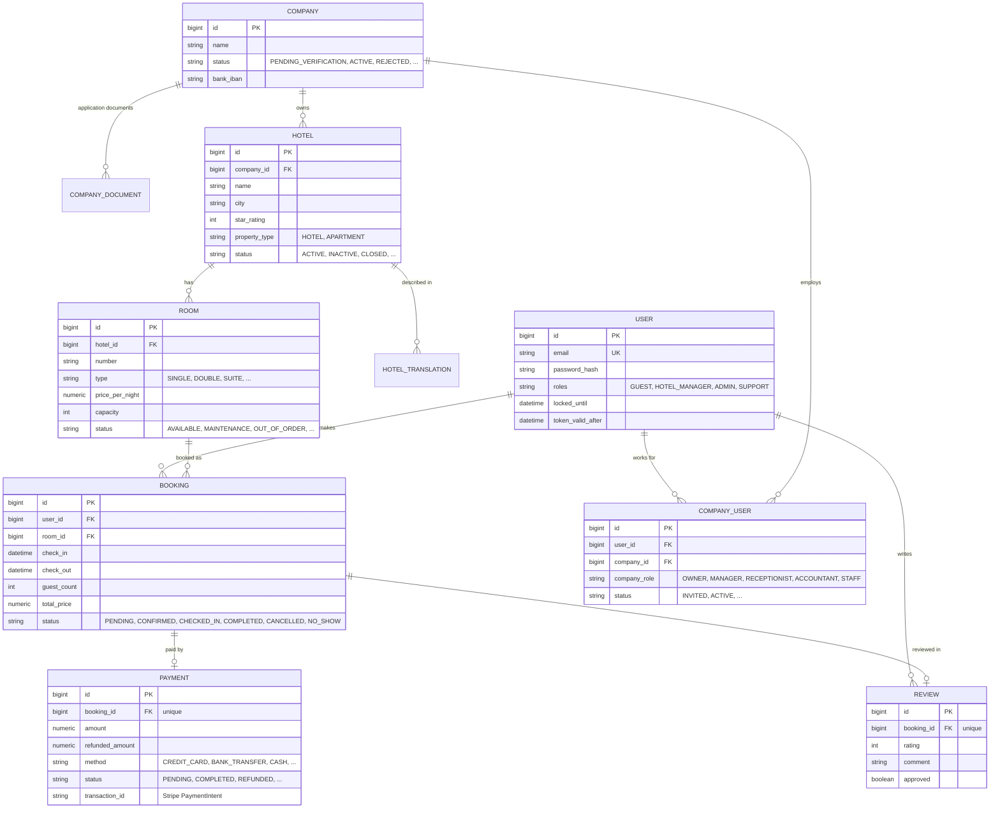
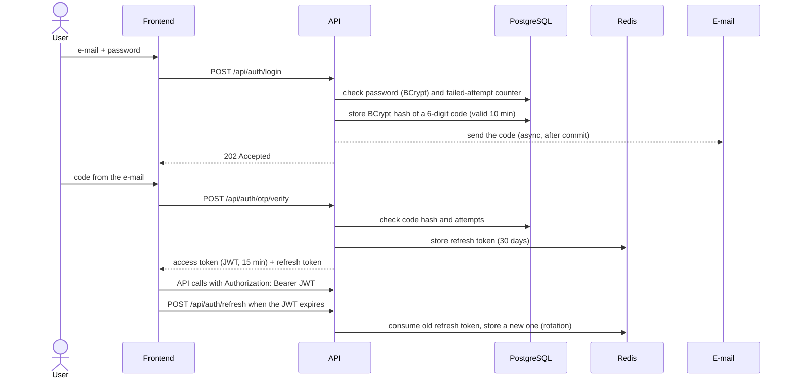

# Folio architecture

How the system is put together: the components, the backend's structure, the data
model, security, and why each technology was chosen. For the booking and payment rules
see [How it works](../README.md#4-how-it-works)
in the main README.

## Contents

1. [Components](#1-components)
2. [Technology choices](#2-technology-choices)
3. [Backend structure](#3-backend-structure)
4. [Data model](#4-data-model)
5. [Security](#5-security)
6. [What Redis is used for](#6-what-redis-is-used-for)
7. [Background work: e-mails and scheduled jobs](#7-background-work-e-mails-and-scheduled-jobs)
8. [API documentation](#8-api-documentation)

---

## 1. Components



| Component | Role |
|---|---|
| **Vue 3 SPA** (`frontend/`) | The whole user interface: guest site, hotel extranet, admin pages. Talks to the API over JSON/REST with a JWT in the `Authorization` header |
| **Spring Boot API** (`Hotel-system/`) | All business logic and rules; the only component that touches the database |
| **PostgreSQL** | System of record: users, companies, hotels, rooms, bookings, payments, reviews. Schema managed by Flyway migrations |
| **Redis** | Short-lived data: refresh tokens, revoked access tokens, read caches ([section 6](#6-what-redis-is-used-for)) |
| **Caddy** | Production only: HTTPS certificates (Let's Encrypt) and routing `/api/*` to the API, the rest to the frontend |
| **Stripe** | Card and Google Pay payments, refunds; reports results back through signed webhooks |
| **SMTP** | Sign-in codes and booking/payment e-mails. Locally Mailpit catches everything; in production e.g. Gmail |

Locally (`docker compose up`) there is no Caddy: the browser calls the frontend on
`:5173` and the API on `:8081` directly.

## 2. Technology choices

| Choice | Why |
|---|---|
| **Spring Boot 3, Java 17** | Mature ecosystem for exactly this kind of app: Spring Security for auth, Spring Data JPA for persistence, declarative transactions, scheduling and caching, and first-class test support |
| **PostgreSQL** | Bookings and payments need real transactions and constraints. Money is stored as `numeric(12,2)`, never floating point |
| **Flyway** | The schema is versioned SQL (`db/migration`), applied identically to local, test and production databases. Demo data lives separately (`db/seed`) |
| **Redis** | Data that must expire on its own (refresh tokens, revoked tokens) and caches shared by all API instances. Redis TTLs do the expiry, no clean-up jobs needed |
| **JWT + refresh tokens** | The API is stateless (no server sessions), so a restart or redeploy logs nobody out. Access tokens live 15 minutes; refresh tokens keep the session for 30 days and can be revoked |
| **E-mail code (OTP) as a second step** | Every sign-in proves the user still owns the e-mail address, so a leaked password alone is not enough to get in |
| **Stripe** | Card data never touches this server (PCI scope stays with Stripe), 3-D Secure works out of the box, and test mode allows a full demo with no real money |
| **Vue 3 + TypeScript + Vite** | Typed single-page app; Pinia for state, vue-i18n for 7 languages, Tailwind for styling |
| **Docker Compose** | One command starts the whole stack, with the same images in development and production |
| **Testcontainers** | Integration tests run against a real PostgreSQL 16 with the real migrations, not an in-memory substitute |

## 3. Backend structure

All code lives under the base package `com.folio`, organised **by feature**, not by
technical layer: everything about bookings lives in `com.folio.booking`, everything about
payments in `com.folio.payment`, and so on.

| Package | Responsibility |
|---|---|
| `user` | accounts, sign-in (password, e-mail code, Google), JWT, profile, e-mail sending |
| `companies` | host companies, the "become a host" application and its documents, admin approval |
| `companyuser` | company staff: invitations, company roles, `CompanyAuthorization` (who may do what in which company) |
| `hotels` | hotels and apartments, amenities, translated descriptions |
| `room` | rooms, availability search |
| `booking` | reservations and their lifecycle, scheduled clean-up |
| `payment` | payments (Stripe and offline), refunds, Stripe webhooks |
| `reviews` | guest reviews after a completed stay, moderation |
| `admin` | administrator user management |
| `config` | Redis, static files, API docs, production safety check |
| `exception` | one JSON error format for the whole API (`GlobalExceptionHandler`) |

Inside each feature the same layers repeat:



- **Controllers** only map HTTP to service calls and declare who may call them.
- **Services** hold every business rule (state transitions, price calculation, overlap
  checks) inside a transaction.
- **Entities never leave the service layer**: the API returns `*Response` DTOs and
  accepts validated `*Request` DTOs.
- **Errors** are thrown as exceptions (`IllegalStateException`, `ConflictException`,
  `ResourceNotFoundException`) and turned into consistent JSON responses with the right
  HTTP status (400, 404, 409 …) in one place.

## 4. Data model



Key rules the model enforces:
- A **company** owns hotels; people work for a company through **company_users**, each
  with a company role. One person can belong to several companies with different roles.
- A **booking** is for one room. Overlapping bookings for the same room are rejected
  (cancelled bookings don't count).
- A booking has **at most one payment** and **at most one review**. A review is only
  allowed after a `COMPLETED` stay and is shown publicly once hotel staff approve it.
- The booking stores its **total price** at the moment of booking, so later room price
  changes don't affect existing bookings.

The full schema is the Flyway migrations in `Hotel-system/src/main/resources/db/migration/`:
`V1__baseline_schema.sql` plus the later changes (`V2__money_as_numeric.sql` moved all
money columns from floating point to exact `numeric(12,2)`).

## 5. Security

### Signing in

Sign-in has two steps: the password, then a 6-digit code sent by e-mail.



Registration uses the same code step first (to prove the e-mail address), then
`/api/auth/complete-registration`. Google sign-in verifies Google's ID token on the
server instead.

### Tokens

| Token | Lifetime | Stored | Revoked by |
|---|---|---|---|
| Access token (signed JWT) | 15 min | nowhere: the API is stateless | logout puts its ID on a Redis blacklist until it would have expired; a password change invalidates all older tokens (`token_valid_after`) |
| Refresh token (random) | 30 days | Redis | used once (rotated on every refresh), deleted on logout |
| Sign-in code (6 digits) | 10 min | PostgreSQL, **BCrypt-hashed** | used once |

### Brute-force protection

- **Password:** 5 wrong attempts lock the account for 15 minutes.
- **E-mail code:** 5 wrong attempts invalidate the code; at most 5 codes per hour, and
  30 s between them.
- **Production safety check** (`config.ProductionSafetyCheck`): the `prod` profile
  refuses to start with the public development JWT key, with codes printed to the log,
  or with the test accounts loaded.

### Authorization: who may do what

There are two levels of roles:

| Level | Roles | Where it applies |
|---|---|---|
| **Global** (`user_roles`) | `GUEST` (everyone), `HOTEL_MANAGER` (has an approved company), `ADMIN`, `SUPPORT` | the whole platform |
| **Company** (`company_users`) | `OWNER`, `MANAGER`, `RECEPTIONIST`, `ACCOUNTANT`, `STAFF` | only inside that one company |

Every endpoint declares its rule with `@PreAuthorize`, for example:

```java
@PreAuthorize("@companyAuth.isBookingOwner(#request.bookingId) or hasRole('ADMIN') "
        + "or @companyAuth.hasRoleForBooking(#request.bookingId, 'OWNER', 'MANAGER', 'RECEPTIONIST')")
```

`CompanyAuthorization` (bean `companyAuth`) answers questions like "does this user have
one of these roles **in the company that owns this booking**?". A receptionist of
company A can confirm A's bookings but cannot see company B's at all.

Public without signing in: browsing hotels and rooms, approved reviews, the health
check, and the Stripe webhook (which proves itself with Stripe's signature instead).

## 6. What Redis is used for

| Use | Key / cache | Expiry |
|---|---|---|
| Refresh tokens | one key per token, plus an index per user | 30 days |
| Revoked access tokens (logout) | the token's ID | the token's remaining lifetime |
| Hotel caches | `hotelById`, `hotelsByCity`, `hotelsByCountry`, … (per language) | evicted when a hotel changes |
| Room availability cache | `roomsAvailability` | evicted on every booking change |

A stale cache can at worst show a slightly old hotel list. Booking rules are always
checked against PostgreSQL inside a transaction, never against the cache.

## 7. Background work: e-mails and scheduled jobs

**E-mails** are sent asynchronously and only **after the database transaction
commits** (`@TransactionalEventListener(AFTER_COMMIT)` + `@Async`). A slow mail server
never slows down a request, and no e-mail goes out for a change that was rolled back.

**Scheduled jobs** run every 15 minutes:
- cancel bookings the hotel never confirmed (48 h) or the guest never paid (24 h);
- mark guests who didn't arrive as `NO_SHOW`;
- expire card payments that were started but never finished.

Details: [How it works](../README.md#4-how-it-works).

## 8. API documentation

The API documents itself with OpenAPI (springdoc). With the local stack running, open
**http://localhost:8081/swagger-ui.html** to see every endpoint with its parameters and
response types, and to call them from the browser.


To call protected endpoints: sign in through `/api/auth/login` and
`/api/auth/otp/verify` (the code arrives in Mailpit, http://localhost:8025), copy
`auth.token` from the response, click **Authorize** and paste it.

The raw OpenAPI spec is at http://localhost:8081/v3/api-docs. Both are switched off in
the `prod` profile.
